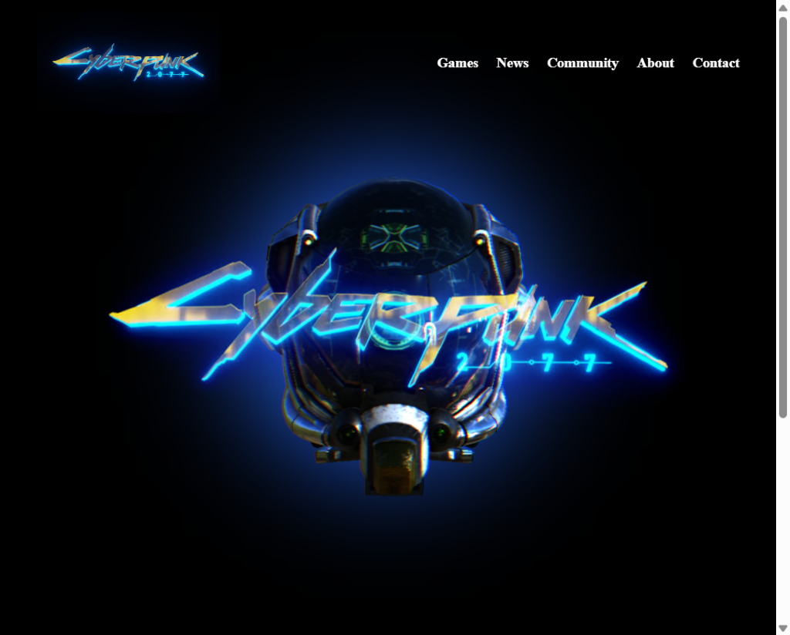

# Cyberpunk 3D Web Experience

An interactive 3D web application built with **Three.js**, **GSAP**, and **Vite**.



## 🌐 Live Demo
🔗 **[Live Website Preview](https://faisalali06870-commits.github.io/cyberpunk/)**

---

## 📌 Project Overview
Cyberpunk is a futuristic interactive 3D landing page experience. It renders a high-fidelity 3D Damaged Helmet model in WebGL with realistic PBR textures, reflective HDRI environment lighting, custom post-processing chromatic aberration glitch shaders, and interactive cursor tilt animations.

---

## 🛠️ Technology Stack
- **Three.js (`^0.185.1`)**: 3D scene creation, camera rendering, GLTFLoader, RGBELoader, OrbitControls.
- **GSAP (`^3.15.0`)**: Smooth cursor-based interactive model rotation and easing.
- **Post-Processing (`EffectComposer` & `RGBShiftShader`)**: Cyberpunk-style chromatic aberration / RGB color shift effect.
- **Locomotive Scroll (`^5.0.1`)**: Smooth scroll experience.
- **Tailwind CSS**: Modern futuristic UI layout and navigation.
- **Vite (`^8.2.2`)**: Ultra-fast build tool and development server.

---

## 🚀 Getting Started

### Prerequisites
- Node.js (v18 or higher recommended)
- npm or pnpm

### Installation
```bash
git clone https://github.com/faisalali06870-commits/cyberpunk.git
cd cyberpunk
npm install
```

### Running Locally
```bash
npm run dev
```
Open [http://localhost:5173/](http://localhost:5173/) in your browser.

### Production Build
```bash
npm run build
```
